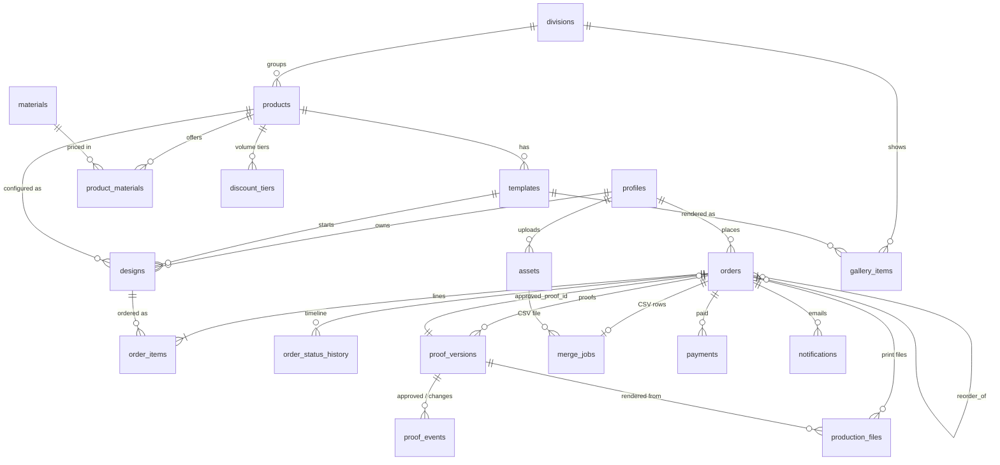

# Database schema

Postgres on Supabase. Everything is created by the migrations in
[`supabase/migrations/`](../supabase/migrations/) (applied in filename order) and the catalogue
seed in [`supabase/seed.sql`](../supabase/seed.sql). TypeScript types are generated from the
database into [`src/types/db.ts`](../src/types/db.ts) (`pnpm db:types`).

Conventions: money totals are integer **minor units** (`*_minor`); rates are `numeric`, priced with
a decimal library; physical sizes are **millimetres** (`*_mm`); every table has Row Level Security on.

## Entities

## Tables

| Group      | Table                            | Holds                                                                                                                                                                                                                                            |
| ---------- | -------------------------------- | ------------------------------------------------------------------------------------------------------------------------------------------------------------------------------------------------------------------------------------------------ |
| People     | `profiles`                       | One row per auth user: name, company, phone, `role` (customer or admin). Created by a trigger on sign-up.                                                                                                                                        |
| Catalogue  | `divisions`                      | The six print divisions (new divisions are rows, not code).                                                                                                                                                                                      |
|            | `products`                       | Parameter-driven products: size limits, quantity rules, base price, setup fee, personalisation fee, bleed, safe margin, output DPI, mirroring, CSV support, option groups.                                                                       |
|            | `materials`, `product_materials` | Materials and the per-product price per cm² / per item, with one default.                                                                                                                                                                        |
|            | `discount_tiers`                 | All-units volume tiers; `product_id` null = shop-wide default.                                                                                                                                                                                   |
|            | `templates`                      | Design templates (a `DesignDocument` JSON with print areas and placeholders), grouped.                                                                                                                                                           |
|            | `gallery_items`                  | Sample work: a template with its own text, a stored design, or a photo.                                                                                                                                                                          |
|            | `settings`                       | One row: currency, tax rate and label, CSV row cap, company details, Xero import settings.                                                                                                                                                       |
| Artwork    | `assets`                         | Uploaded files (logos, finished artwork, CSV), checked by content on the server.                                                                                                                                                                 |
|            | `designs`                        | Saved designs: configuration + document + optional CSV mapping. Locked once a proof is approved.                                                                                                                                                 |
| Orders     | `orders`                         | One order = one print job: status, server-calculated price breakdown and frozen pricing snapshot, payment and invoice number, approval gate (`approved_proof_id`, `files_unlocked_at`), reorder link and confirmation, archive and cancel times. |
|            | `order_items`                    | Xero-shaped invoice lines with the frozen configuration and artwork.                                                                                                                                                                             |
|            | `order_status_history`           | Every stage change with who and why.                                                                                                                                                                                                             |
|            | `payments`, `webhook_events`     | Payments as reported by Stripe; processed webhook ids (idempotency).                                                                                                                                                                             |
| Proofs     | `proof_versions`                 | Immutable proof versions: artwork and config snapshot, sha256, proof PDF and PNG, source (customer edit, staff upload, reorder).                                                                                                                 |
|            | `proof_events`                   | Approvals and change requests with IP, browser and the hash approved.                                                                                                                                                                            |
| Production | `merge_jobs`                     | CSV rows frozen at checkout with their hash, and batch progress.                                                                                                                                                                                 |
|            | `production_files`               | Print files from the approved proof (PDF, PNG, per-row files, ZIP) with sizes and hashes.                                                                                                                                                        |
| Operations | `notifications`                  | Every email and in-app message, with delivery status.                                                                                                                                                                                            |
|            | `audit_logs`                     | Staff actions: production, downloads, role changes, catalogue edits, exports.                                                                                                                                                                    |
|            | `rate_limits`                    | Fixed-window counters for the Postgres-backed rate limiter.                                                                                                                                                                                      |

## Order pipeline

`quote → order → artwork → proof → production → completed`, plus `cancelled` from any stage
before production and `proof → artwork` when changes are requested. `order_transition_allowed`
defines the allowed moves; the `orders_guard` trigger enforces them for every writer, along with
the rules that an order is only `order` once paid, only `production` once a proof is approved,
and only archived once finished.

## Security model

- **Customers** read their own rows only (RLS on `customer_id` / `owner_id` / `user_id`). They can
  write their profile contact fields (column grants keep `role` out of reach), their own designs
  and their own uploads. They cannot write orders, payments, proofs, approvals or print files.
- **Admins** (`profiles.role = 'admin'`, checked by `is_admin()`) read everything; staff changes go
  through server code.
- **Server code** uses the service role for writes customers must not make (orders from checkout,
  payments from verified webhooks, proofs, print files). Every such function is `security
definer`, granted to `service_role` only, and the admin ones re-check the actor with
  `assert_admin`.
- **Visitors** read the active catalogue and gallery only.
- Proven by pgTAP: `01_security_and_pipeline` and `09_cross_tenant` (customer B against customer
  A's data in every table and bucket).

## Functions (server-only unless noted)

| Function                                                                      | Does                                                                                                                                                                                                                 |
| ----------------------------------------------------------------------------- | -------------------------------------------------------------------------------------------------------------------------------------------------------------------------------------------------------------------- |
| `transition_order`                                                            | The one way to move an order through the pipeline, recording who and why.                                                                                                                                            |
| `next_invoice_number`                                                         | `INV-YYYY-NNNNNN` on payment.                                                                                                                                                                                        |
| `create_proof_version`                                                        | Records the next proof version atomically (version numbers can't collide).                                                                                                                                           |
| `approve_proof`, `request_proof_changes`                                      | The customer's decision on the latest pending proof, logged with IP and browser; approval unlocks print files and locks the design.                                                                                  |
| `approve_reorder_proof`                                                       | Approves a reorder's proof only if its hash equals the original approval.                                                                                                                                            |
| `start_production`                                                            | Moves an approved order with its print PDF into production.                                                                                                                                                          |
| `admin_order_action`                                                          | Complete, cancel (reason required), archive, unarchive; audited.                                                                                                                                                     |
| `admin_set_role`                                                              | Role change, audited; never your own, never the last admin.                                                                                                                                                          |
| `admin_user_directory`                                                        | Users with sign-in email and order totals for the admin.                                                                                                                                                             |
| `admin_update_product`, `admin_update_template`, `admin_update_xero_settings` | Catalogue and settings edits, atomic and audited.                                                                                                                                                                    |
| `check_rate_limit`                                                            | Fixed-window rate limiting.                                                                                                                                                                                          |
| `is_admin` (callable by signed-in users)                                      | Used by RLS policies.                                                                                                                                                                                                |
| Triggers                                                                      | `handle_new_user`, `orders_guard`, `orders_log_status`, `designs_guard`, `proof_versions_guard`, `production_files_guard`, `prevent_mutation` / `prevent_delete` (history tables are append-only), `set_updated_at`. |

## Storage buckets

| Bucket       | Public | Contents                         | Access                                                                               |
| ------------ | ------ | -------------------------------- | ------------------------------------------------------------------------------------ |
| `catalogue`  | yes    | Product and gallery images       | Anyone reads; admins write.                                                          |
| `uploads`    | no     | Customer files in `{userId}/…`   | Owner reads, uploads and deletes in their own folder; admins read.                   |
| `proofs`     | no     | Proof PDF and PNG per version    | Admins read; customers get 1-hour signed links for their own orders only.            |
| `production` | no     | Print files in `{OrderNumber}/…` | Admins only; downloads go through an audited 60-second signed link. Customers never. |
